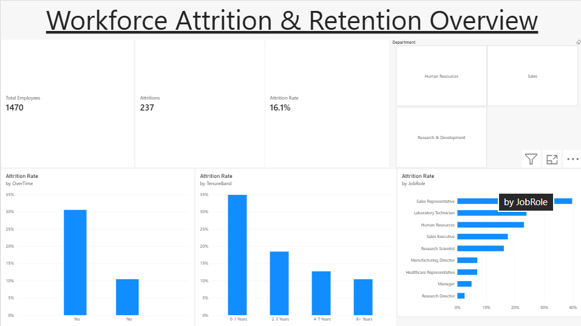

# HR Attrition Analysis

End-to-end HR People Analytics project that cleans raw employee data, loads it into SQLite, queries it with SQL, and visualizes the key drivers of employee attrition in Power BI.

## Business Question

Which factors are most associated with employees leaving the company, and where should HR focus retention efforts?

## Tech Stack

| Area | Tools |
|---|---|
| Data cleaning | Python |
| Storage | SQLite |
| Analysis | SQL |
| Visualization | Power BI |
| Version control | Git / GitHub |

## Dataset

- Source: [add dataset name and link]
- Size: [add number of rows] employees, [add number of columns] columns
- Target column: Attrition (Yes / No)

## Pipeline

1. **Clean** raw HR data (`clean_data.py`): handle missing values, fix data types, standardize columns.
2. **Load** the cleaned data into a SQLite database (`load_to_sqlite.py`).
3. **Query** attrition trends and workforce metrics with SQL (`run_queries.py`, `sql/`).
4. **Visualize** the findings in a Power BI dashboard.
5. **Test** that the load completed correctly (`test_load.py`).

## Project Structure

```
hr-attrition-analysis/
├── data/               # raw and cleaned datasets
├── notebooks/          # exploration notebooks
├── sql/                # SQL queries for attrition analysis
├── clean_data.py       # data cleaning
├── load_to_sqlite.py   # load cleaned data into SQLite
├── run_queries.py      # run SQL queries and print results
├── test_load.py        # check the database load
├── requirements.txt    # Python dependencies
└── image.png           # dashboard preview
```

## Dashboard Preview



## Key Insights

- [Finding 1, for example: overall attrition rate is X%]
- [Finding 2, for example: attrition is highest in department / role / age group Y]
- [Finding 3, for example: overtime / income / tenure shows the strongest link]

## How to Run

```bash
git clone https://github.com/anurag-arun/hr-attrition-analysis.git
cd hr-attrition-analysis
pip install -r requirements.txt

python clean_data.py
python load_to_sqlite.py
python run_queries.py
```

Open the Power BI file to explore the dashboard.

## What I Learned

- Building a repeatable data pipeline from raw file to SQL database
- Writing SQL queries to answer business questions
- Turning query results into clear Power BI visuals

## Author

**Anurag** · [GitHub](https://github.com/anurag-arun) · [LinkedIn](https://www.linkedin.com/in/anurag-n-0a6824280)
